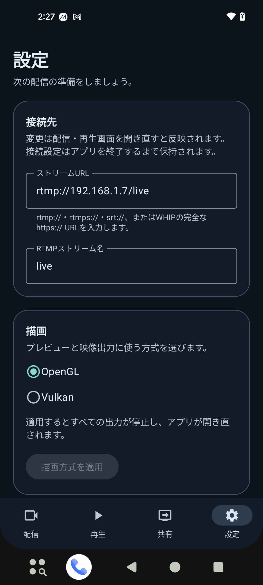

# 📱 Android sample app

[](https://github.com/HaishinKit/HaishinKit.kt/actions/workflows/android.yml)
[](../README.md)
[](../LICENSE.md)

The sample demonstrates camera publishing, playback, recording, screen sharing,
and screen composition. It requires **Android 10 (API 29) or later** so it can
include the optional libdatachannel-based RTC module. The core and RTMP/SRT
libraries retain their API 23 minimum.

## 🎨 Screens

Publishing, settings and screen sharing in the sample app, shown in English on a Pixel 5a:

<p>
  
  
  
</p>

## 🛠️ Build and run

The interface uses a navy-and-teal studio theme with English and Japanese labels.
Swipe the preview background left or right to change filters. Phones use bottom
navigation and a camera-tools sheet. Wide windows use a navigation rail with
publishing and playback controls beside the video. The tablet publishing preview
fits the whole composition; camera tools scroll while primary actions stay visible.
Narrow or short windows return to compact controls without recreating the preview.
The launcher icon matches the Swift sample.

In **Settings → Device codecs**, check video and audio encoding/decoding support,
hardware/software implementations, and codec details reported by the device.
Device support does not imply support in every HaishinKit streaming protocol.

Open the repository in Android Studio and run the `app` configuration on a device.
Grant camera and microphone permissions for camera publishing. For command-line
builds, configure `JAVA_HOME` and the Android SDK/NDK versions used by Gradle:

```sh
./gradlew :app:assembleDebug
./gradlew :app:installDebug
```

The first native build downloads the pinned transport dependencies. A WHIP/WHEP
server and endpoints for the stream you want to send or receive are required for
network testing. The sample does not run a streaming server.

## 🎞️ Video objects

Tap an empty part of the Publish preview, then choose **Sample video**. The clip
loops without audio and can be moved, resized or deleted like other objects.
It reuses the [Swift sample movie](https://github.com/HaishinKit/HaishinKit.swift/blob/main/Examples/macOS/SampleVideo_360x240_5mb.mp4).
The sample accepts up to four video objects. Playback uses the device's OS decoder;
unsupported videos report an error. Video pauses when leaving Publish and restarts
when returning. No extra codec package or video-storage permission is needed.

## 💾 Scene files

In **Publish → Camera tools → Scene**, choose **Save scene** to export a portable
`.scene` file, or **Open scene** to replace the current composition. Stop streaming
and recording first. Android's file picker lets you choose where to save or open.

Files retain the canvas size, object placement, text, images, local video files and
the sample's animation. Video playback restarts from the beginning on restore. Restored top-level text and images remain editable; nested containers move and
delete as groups. The preview fits the
saved canvas. Camera objects use the current capture sources; files do not contain
camera footage, permissions or streaming credentials. Unknown objects are retained
when saving again but are not rendered by the sample.

The sample accepts archives and expanded contents up to 32 MiB, a canvas up to
4096 pixels per side and 8 megapixels total, and images up to 16 megapixels total. Text and animation layers are limited to
4096 pixels per side and 8 megapixels total. Deleted media is removed on save;
files with unknown objects retain all resources to preserve those objects.

## 💬 ChatGPT and composition tools

Open **Publish → AI chat → Continue with ChatGPT** to ask about the current
composition using an eligible ChatGPT plan. Approve each new camera image before
it is sent. This local, open-source sample needs no API key or client secret.
See the [authentication and local MCP guide](../mcp/module-docs.md#android-ai-chat-sample)
for setup, data handling, limitations, and validation steps.

## 📡 Bonjour SRT publishing

On the Mac sample, open **Playback**, start the SRT listener and enable its
Bonjour announcement. Connect both devices to the same local network. On Android,
open **Publish → Find receiver**, allow local network access if requested, and
select the Mac. Then tap **Go live** to send camera video and microphone audio.
Stop publishing before choosing a different receiver.

Discovery uses the samples' `_srt._udp` convention with TXT `role=receiver`.
It sets an SRT caller URL using the advertised address and port. Scoped/link-local
IPv6 destinations are excluded because the SRT transport does not yet support
them; IPv4 is preferred when advertised. Ordinary SRT servers appear only if they
publish a compatible Bonjour service. Searching stops when the dialog closes or
the app enters the background.

## 📡 WHIP publishing and WHEP playback

In the **Settings** tab, set the following fields:

| Field | Value |
|---|---|
| Stream URL | The complete WHIP `http://` or `https://` endpoint, including its path and query parameters. HTTP(S) selects WebRTC. |
| WHEP playback URL | The complete WHEP endpoint for the stream to watch. Required for WebRTC playback. |
| Bearer token (optional) | The token without the `Bearer ` prefix. Leave empty when authentication is not needed. Used for both endpoints. |
| STUN / TURN servers (optional) | One libdatachannel-compatible ICE server URL per line, for example `stun:stun.example.com:3478`. Configure TURN if your network requires it. |

**RTMP stream name** is disabled for HTTP(S) and is not appended to either URL.
Use the endpoints provided by your server; WHEP paths are not inferred from WHIP.
Settings are retained in memory for the current app process, including credentials.
Reopen the corresponding tab after editing settings to create a session with the
updated URLs, token, and ICE servers.

For publishing:

1. Open **Publish** and grant camera/microphone permissions.
2. Choose a camera if necessary, then tap **Go live**.
3. Tap **Stop stream** to disconnect, or **Cancel** while connecting when available.

For playback:

1. Open **Playback** and tap **Play stream**.
2. Tap **Stop stream** to disconnect, or **Cancel** while connecting when available.

Keep Publish open and use another device/player to test continuous WHIP publishing
and WHEP playback together. Leaving the Publish tab stops its camera/microphone
capture. Playback errors are displayed on screen; publishing errors appear as
messages. An authentication failure is reported with the HTTP status code.

The sample allows plain HTTP for local testing and uses Android's normal HTTPS
certificate validation. Use reachable server addresses when testing on a physical
device: `127.0.0.1` refers to that device, not the development computer. On Android
versions requiring local network permission, use **Allow local network** in Settings.

Outgoing WebRTC media uses H.264 Baseline level 3.1, VP8 or VP9 profile 0 with Opus. The sample captures
48 kHz PCM and applies the same rate to its recording and publishing encoders.
Read the [RTC module guide](../rtc/README.md) for supported signaling, transport
limitations and library-level usage.

## 🔌 RTMP and SRT

For RTMP/RTMPS, enter the base stream URL and **RTMP stream name**. For SRT, enter
the full `srt://` URI including options such as `mode`, `streamid`, and `latency`;
RTMP stream name is ignored. Publish and Playback select the session's media
mode. The sample continues to use AAC for RTMP and SRT at a 48 kHz sample rate.

See the [SRT guide](../srt/README.md) for socket modes and encryption options.

## 🖥️ Screen sharing and renderer selection

**Share** uses the same publishing endpoint, authentication and ICE
settings as the Publish tab. Tap **Start screen sharing**, then confirm the
Android screen-capture prompt.
**Apply renderer** in Settings stops active outputs and reopens the app screens.
The existing OpenGL and optional Vulkan backends are available.

## ✅ Validation

### 🤖 MCP example

Debug builds opt into the optional [MCP library](../mcp/README.md). Open Publish
to expose its composition through `capture_frame`; release and UI-test builds
do not start an MCP endpoint. The debug adapter logs its instance token under
`DebugMcpServer` for local testing.

See the [Dokka guide](../mcp/module-docs.md) for lifecycle, authentication, custom
tools and packaging. `app/scripts/mcp_smoke.rb` checks connectivity; set
`MCP_TOKEN` to the current debug token and optionally `MCP_CAPTURE_OUTPUT` to a
JPEG path to test capture. Keep Publish visible for capture.

### 🧪 App checks

Both `debug` and `release` enable full R8 and resource optimization. The optimized
`debug` variant is non-debuggable; white-box Compose tests and LeakCanary use
the dedicated `uiTest` variant. See [R8 verification](../.github/docs/r8.md) for
consumer rules, device smoke checks, and release mapping files.

```sh
./gradlew :app:testDebugUnitTest :app:testUiTestUnitTest :app:ktlintCheck
./gradlew :app:connectedUiTestAndroidTest
```

Adaptive layout tests cover side panels, narrow/short windows, readable playback
errors, scrolling tools, PiP,
and retaining the native preview across window resizing.

The sample's device test enters WHIP/WHEP settings and opens the publishing and
playback screens without contacting an external server. Transport and real codec
round-trip tests live in the [RTC module](../rtc/README.md#building-and-validation).
