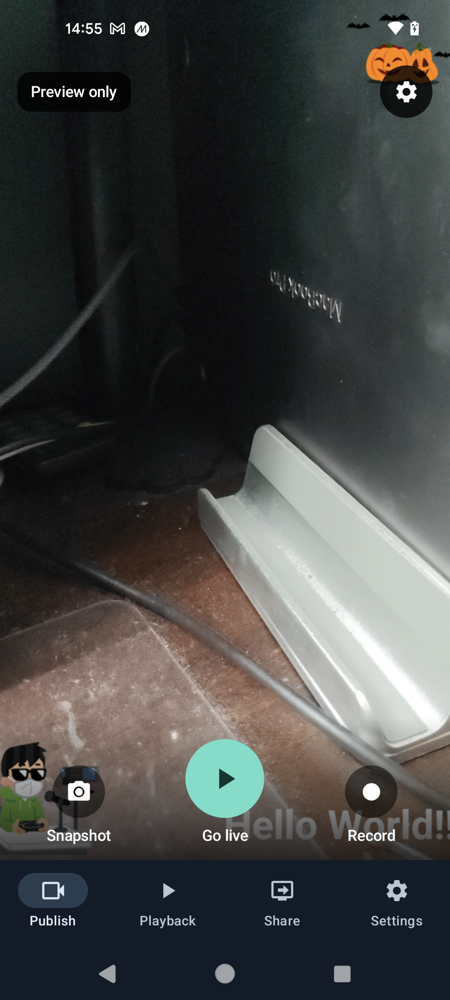
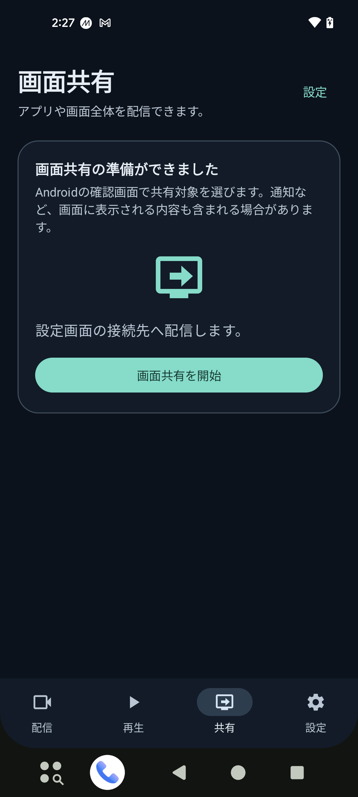

# 📱 Android sample app

[](https://github.com/HaishinKit/HaishinKit.kt/actions/workflows/android.yml)
[](../README.md)
[](../LICENSE.md)

The sample demonstrates camera publishing, playback, recording, screen sharing,
and screen composition. It requires **Android 10 (API 29) or later** so it can
include the optional libdatachannel-based RTC module. The core and RTMP/SRT
libraries retain their API 23 minimum.

## 🎨 Screens

Publishing, settings and screen sharing in the sample app, shown in English on a Pixel 5a:

<p>
  
  
  
</p>

## 🛠️ Build and run


The interface uses a navy-and-teal studio theme with English and Japanese labels.
Swipe the preview background left or right to change filters. Camera tools open in a bottom sheet; phones use bottom navigation and wider windows use
a navigation rail. The launcher icon matches the Swift sample.

Open the repository in Android Studio and run the `app` configuration on a device.
Grant camera and microphone permissions for camera publishing. For command-line
builds, configure `JAVA_HOME` and the Android SDK/NDK versions used by Gradle:

```sh
./gradlew :app:assembleDebug
./gradlew :app:installDebug
```

The first native build downloads the pinned transport dependencies. A WHIP/WHEP
server and endpoints for the stream you want to send or receive are required for
network testing. The sample does not run a streaming server.

## 📡 Bonjour SRT publishing

On the Mac sample, open **Playback**, start the SRT listener and enable its
Bonjour announcement. Connect both devices to the same local network. On Android,
open **Publish → Find receiver**, allow local network access if requested, and
select the Mac. Then tap **Go live** to send camera video and microphone audio.
Stop publishing before choosing a different receiver.

Discovery uses the samples' `_srt._udp` convention with TXT `role=receiver`.
It sets an SRT caller URL using the advertised address and port; ordinary SRT
servers appear only if they publish a compatible Bonjour service. Searching
stops when the dialog closes or the app enters the background.

## 📡 WHIP publishing and WHEP playback

In the **Settings** tab, set the following fields:

| Field | Value |
|---|---|
| Stream URL | The complete WHIP `http://` or `https://` endpoint, including its path and query parameters. HTTP(S) selects WebRTC. |
| WHEP playback URL | The complete WHEP endpoint for the stream to watch. Required for WebRTC playback. |
| Bearer token (optional) | The token without the `Bearer ` prefix. Leave empty when authentication is not needed. Used for both endpoints. |
| STUN / TURN servers (optional) | One libdatachannel-compatible ICE server URL per line, for example `stun:stun.example.com:3478`. Configure TURN if your network requires it. |

**RTMP stream name** is disabled for HTTP(S) and is not appended to either URL.
Use the endpoints provided by your server; WHEP paths are not inferred from WHIP.
Settings are retained in memory for the current app process, including credentials.
Reopen the corresponding tab after editing settings to create a session with the
updated URLs, token, and ICE servers.

For publishing:

1. Open **Publish** and grant camera/microphone permissions.
2. Choose a camera if necessary, then tap **Go live**.
3. Tap **Stop stream** to disconnect, or **Cancel** while connecting when available.

For playback:

1. Open **Playback** and tap **Play stream**.
2. Tap **Stop stream** to disconnect, or **Cancel** while connecting when available.

Keep Publish open and use another device/player to test continuous WHIP publishing
and WHEP playback together. Leaving the Publish tab stops its camera/microphone
capture. Playback errors are displayed on screen; publishing errors appear as
messages. An authentication failure is reported with the HTTP status code.

The sample allows plain HTTP for local testing and uses Android's normal HTTPS
certificate validation. Use reachable server addresses when testing on a physical
device: `127.0.0.1` refers to that device, not the development computer. On Android
versions requiring local network permission, use **Allow local network** in Settings.

Outgoing WebRTC media is H.264 Baseline level 3.1 and Opus. The sample captures
48 kHz PCM and applies the same rate to its recording and publishing encoders.
Read the [RTC module guide](../rtc/README.md) for supported signaling, transport
limitations and library-level usage.

## 🔌 RTMP and SRT

For RTMP/RTMPS, enter the base stream URL and **RTMP stream name**. For SRT, enter
the full `srt://` URI including options such as `mode`, `streamid`, and `latency`;
RTMP stream name is ignored. Publish and Playback select the session's media
mode. The sample continues to use AAC for RTMP and SRT at a 48 kHz sample rate.

See the [SRT guide](../srt/README.md) for socket modes and encryption options.

## 🖥️ Screen sharing and renderer selection

**Share** uses the same publishing endpoint, authentication and ICE
settings as the Publish tab. Tap **Start screen sharing**, then confirm the
Android screen-capture prompt.
**Apply renderer** in Settings stops active outputs and reopens the app screens.
The existing OpenGL and optional Vulkan backends are available.

## ✅ Validation

### 🔎 Debug MCP server

Debug builds include an MCP Streamable HTTP server using the official MCP Kotlin
SDK **0.8.4** and Ktor Netty **3.2.3**, matching the project's Kotlin 2.2.21.
The server starts while `MainActivity` is visible and stops when it is stopped
or destroyed. The server itself runs independently of camera permissions and publishing.
Release builds exclude both the server implementation and its dependencies.

Connect a USB-debugging device, install and open the debug sample, then run:

```sh
adb forward tcp:8080 tcp:8080
# Copy the current process token from Logcat (DebugMcpServer: MCP bearer token).
export MCP_TOKEN='<token from Logcat>'
ruby app/scripts/mcp_smoke.rb
```

The check initializes MCP, lists tools, calls `hello_android`, and checks rejection
of untrusted Host/Origin headers and invalid bearer tokens. The tool takes `{}` and returns
`Hello from HaishinKit on Android!`; it does not access camera or microphone data.
Use `http://127.0.0.1:8080/mcp` as the Streamable HTTP URL in a native MCP client.
Set the client's `Authorization: Bearer <token>` header. The token is generated
for each app process and logged only by the debug server. Re-read it after a
process restart. No session ID is required: the server uses the SDK's stateless transport.

If the computer's port 8080 is occupied, forward another local port and supply
the device's expected Host header to the smoke check:

```sh
adb forward tcp:18080 tcp:8080
/usr/bin/ruby app/scripts/mcp_smoke.rb http://127.0.0.1:18080/mcp 127.0.0.1:8080
```

On macOS, `/usr/bin/ruby` can run this standard-library-only script even when
the Ruby version selected by the repository is not installed.

The endpoint binds only to the device's loopback address, allows Host values
`127.0.0.1:8080` and `localhost:8080`, and rejects requests with an Origin header.
Browser clients, including browser-based Inspector connections, are not enabled.
All MCP requests require the bearer token. This endpoint is intended for a trusted
development device over adb, not direct LAN access. Startup failures and readiness
are reported in Logcat under `DebugMcpServer`.

Close the sample to stop the server; reopen it to test reconnection. Remove the
forward when finished:

```sh
adb forward --remove tcp:8080
```

### 📷 Capture the Publish composition

Open **Publish**. Grant camera permission if you want a live camera background;
ScreenObject-only compositions can also be captured. No streaming or recording
connection is needed. `capture_frame` returns a base64 JPEG image content block
and structured metadata (`width`, `height`, `renderer`,
`readbackCompletedAtMillis`). The timestamp marks readback completion, not camera
exposure time. App controls and selection outlines are excluded; the whole
composition is captured before preview cropping.

Arguments are optional: `maxWidth` is an integer from 32 to 1920 (default 1280),
`quality` is an integer from 1 to 100 (default 85). Aspect ratio is preserved and
images are never enlarged. Example arguments: `{"maxWidth":640,"quality":85}`.
The result is the currently available composition; a camera frame arriving after
the request is not guaranteed. OpenGL reads its composited framebuffer and Vulkan
renders a snapshot through its existing `readPixels` implementation.

With `MCP_TOKEN` exported, save an image and validate error handling:

```sh
MCP_CAPTURE_OUTPUT=/tmp/haishinkit-composition.jpg ruby app/scripts/mcp_smoke.rb
# After leaving Publish, verify that capture is rejected:
MCP_CAPTURE_EXPECT_UNAVAILABLE=1 ruby app/scripts/mcp_smoke.rb
```

The same optional endpoint and Host arguments work with these checks. Requests
are serialized, image scaling/compression runs off the UI and rendering threads,
and asynchronous readback/queue waiting times out after three seconds. Stopping
Publish invalidates pending results. Synchronous GPU readback and JPEG compression
cannot be forcibly interrupted; their results are discarded on cancellation and
owned Bitmaps are recycled. Capture failures return an MCP tool result with
`isError: true` and a readable message.

### 🧪 App checks

Both `debug` and `release` enable full R8 and resource optimization. The optimized
`debug` variant is non-debuggable; white-box Compose tests and LeakCanary use
the dedicated `uiTest` variant. See [R8 verification](../.github/docs/r8.md) for
consumer rules, device smoke checks, and release mapping files.

```sh
./gradlew :app:testDebugUnitTest :app:testUiTestUnitTest :app:ktlintCheck
./gradlew :app:connectedUiTestAndroidTest
```

The sample's device test enters WHIP/WHEP settings and opens the publishing and
playback screens without contacting an external server. Transport and real codec
round-trip tests live in the [RTC module](../rtc/README.md#building-and-validation).
